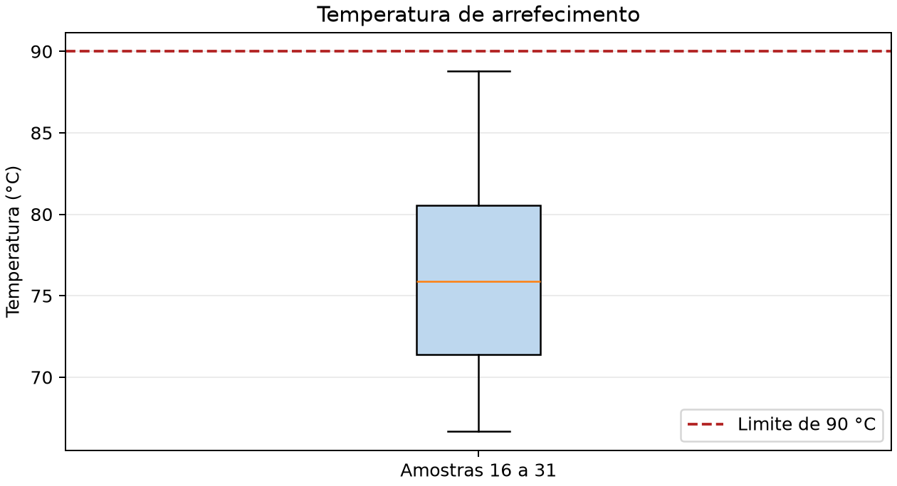
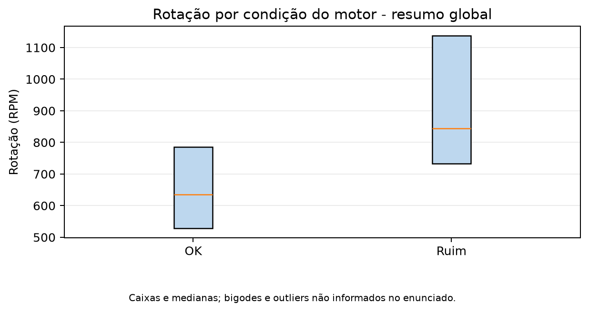

---
lang: pt-BR
---

# Desafio 1 CIDA

**Raphael Gouvêa Reche**  
**RA 26164063**

## 1 Objetivo e seleção das amostras

Analisei a condição do motor por meio das variáveis rotação, pressão de combustível e temperatura de arrefecimento. Desenvolvi em Python a solução dos itens de a a f, com quatro listas de entrada, cálculos estatísticos e geração de gráficos.

### Item a

Selecionei as amostras **16 a 31**, pois identifiquei o algarismo **3** no final do RA 26164063. Transcrevi os 16 registros do enunciado para as listas `rotacao`, `pressao_combustivel`, `temperatura_arrefecimento` e `condicao_motor`, preservando a correspondência entre as posições. Considerei 1 como motor OK e 0 como motor com problema. Mantive a pressão na unidade não especificada no enunciado.

| Amostra | Rotação RPM | Pressão combustível | Temperatura °C | Condição |
|---:|---:|---:|---:|---:|
| 16 | 382 | 7,77 | 71,62 | 1 |
| 17 | 560 | 11,73 | 70,77 | 1 |
| 18 | 767 | 7,50 | 80,27 | 0 |
| 19 | 838 | 4,16 | 88,78 | 1 |
| 20 | 495 | 7,38 | 73,81 | 1 |
| 21 | 1341 | 6,19 | 78,88 | 0 |
| 22 | 1249 | 6,25 | 72,57 | 1 |
| 23 | 699 | 7,33 | 87,12 | 0 |
| 24 | 436 | 7,44 | 82,40 | 1 |
| 25 | 885 | 6,35 | 81,45 | 1 |
| 26 | 583 | 6,15 | 70,61 | 1 |
| 27 | 773 | 6,89 | 68,24 | 1 |
| 28 | 796 | 5,40 | 77,38 | 0 |
| 29 | 591 | 7,86 | 66,67 | 1 |
| 30 | 455 | 13,97 | 75,81 | 1 |
| 31 | 1053 | 4,21 | 75,98 | 0 |

```{=openxml}
<w:p><w:r><w:br w:type="page"/></w:r></w:p>
```

## 2 Temperatura de arrefecimento

### Item b

Calculei os quartis com interpolação linear, pelo método `linear` do NumPy, também adotado pelo boxplot do Matplotlib. Apliquei a regra de 1,5 vez o intervalo interquartil para identificar valores atípicos.

| Medida | Resultado em °C |
|---|---:|
| Mínimo e bigode inferior | 66,6700 |
| Primeiro quartil Q1 | 71,4075 |
| Mediana Q2 | 75,8950 |
| Terceiro quartil Q3 | 80,5650 |
| Máximo e bigode superior | 88,7800 |
| Intervalo interquartil Q3 − Q1 | 9,1575 |
| Limite inferior Q1 − 1,5 × IQR | 57,6713 |
| Limite superior Q3 + 1,5 × IQR | 94,3012 |

Não identifiquei outliers, pois encontrei todos os valores dentro dos limites calculados. Mantive os valores sem arredondamento durante os cálculos e arredondei apenas a apresentação.

{width=15cm}

### Item c

Contei **0 temperaturas acima de 90 °C**, entre 16 observações. Obtive **0/16 × 100 = 0%** de temperaturas elevadas. Confirmei no gráfico o posicionamento de todos os dados abaixo da linha de 90 °C, inclusive do máximo de 88,78 °C. Restringi essa conclusão às amostras selecionadas.

```{=openxml}
<w:p><w:r><w:br w:type="page"/></w:r></w:p>
```

## 3 Rotação e condição do motor

### Item d

Utilizei os resumos globais fornecidos no enunciado, sem substituí-los pelos resultados das 16 amostras.

| Condição | Q1 RPM | Mediana RPM | Q3 RPM |
|---|---:|---:|---:|
| OK | 529 | 635 | 786 |
| Ruim | 733 | 845 | 1137 |

{width=15cm}

Representei as caixas entre Q1 e Q3 e as medianas. Omiti os bigodes e os outliers por não dispor dos extremos nem dos dados brutos globais necessários à sua determinação. Não confundi os limites teóricos de 1,5 IQR com os extremos efetivamente observados.

Identifiquei uma mediana **210 RPM maior** no grupo ruim, com deslocamento dos quartis para rotações mais altas. Observei sobreposição das caixas entre **733 e 786 RPM**. Assim, reconheci uma associação descritiva entre maior rotação e condição ruim, sem concluir causalidade ou estabelecer um diagnóstico apenas pela rotação.

### Item e

Calculei a faixa de um desvio-padrão em torno da média global:

**771,79 − 260,93 = 510,86 RPM**  
**771,79 + 260,93 = 1032,72 RPM**

Obtive o intervalo **[510,86; 1032,72] RPM**. Interpretei a cobertura de aproximadamente 68% sob a hipótese de distribuição aproximadamente normal; não garanti esse percentual apenas com a média e o desvio-padrão.

### Item f

Utilizei Q1 e Q3 globais e obtive **[589; 868,25] RPM** para os **50% centrais** dos valores. Interpretei a expressão “mais prováveis” do enunciado como referência ao intervalo interquartil, sem afirmar que corresponda ao intervalo de maior densidade de probabilidade.

```{=openxml}
<w:p><w:r><w:br w:type="page"/></w:r></w:p>
```

## 4 Organização e execução do programa

Organizei a entrada nas quatro listas exigidas. Implementei `analisar_temperaturas` para os quartis, os limites de outliers e o percentual acima de 90 °C; `gerar_graficos` para as imagens; e `main` para validar as listas, coordenar a execução e salvar as respostas. Configurei o backend `Agg` para gerar os gráficos mesmo sem interface gráfica.

Utilizei Python 3 e as bibliotecas NumPy e Matplotlib. Executei os comandos abaixo no terminal, dentro da pasta do projeto:

```powershell
python -m pip install -r requirements.txt
python desafio1.py
```

Obtive a tabela das amostras e as respostas no terminal. Gravei também `respostas.txt`, `boxplot_temperatura.png` e `boxplot_rotacao.png` na pasta `resultados`, localizada junto ao programa.

### Saída principal esperada

```text
b) Q1 = 71.4075; mediana = 75.8950; Q3 = 80.5650 °C.
IQR = 9.1575; limites = [57.6713, 94.3012] °C.
Outliers: [] (regra 1,5 IQR).
c) Temperaturas acima de 90 °C: 0/16 = 0.00%.
d) Mediana OK = 635 RPM; ruim = 845 RPM. Diferença = 210 RPM.
e) Média +/- desvio: [510.86, 1032.72] RPM.
f) 50% centrais: [589.00, 868.25] RPM.
```

### Erros comuns e soluções

| Situação | Solução |
|---|---|
| Módulo NumPy ou Matplotlib ausente | Instalar com `python -m pip install -r requirements.txt`. |
| Arquivo do programa não encontrado | Abrir o terminal na pasta que contém `desafio1.py`. |
| Quartis diferentes em outro método | Selecionar interpolação linear para reproduzir os resultados. |
| Uso de vírgula decimal nas listas Python | Utilizar ponto decimal no código e vírgula na redação. |

## 5 Verificação e entrega

Executei o programa e conferi os 16 registros, os quartis, o percentual de temperaturas elevadas e os intervalos globais. Verifiquei a criação das duas imagens e do arquivo de respostas.

- [x] Identificação com nome e RA.
- [x] Quatro listas com as amostras 16 a 31.
- [x] Respostas dos itens a a f e dois gráficos.
- [x] Código Python e instruções de execução.
- [x] Documentação com descrição dos métodos e limitações.

**Fonte dos dados:** enunciado fornecido em Desafio1.pdf, páginas 1 e 2.

